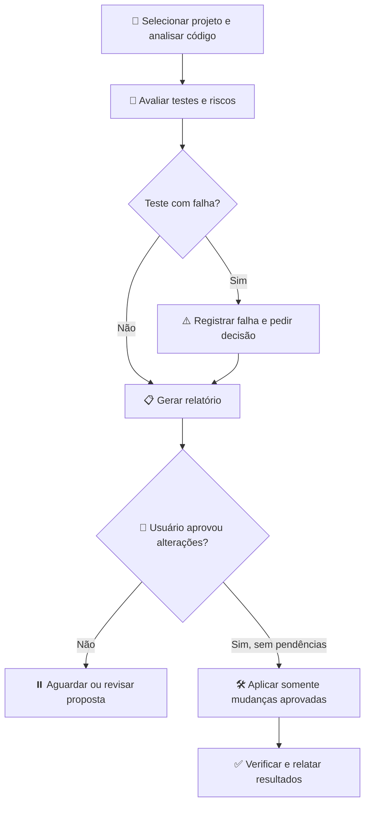

# 🛡️ RefactorGuard — Agente de IA para Análise e Refatoração de Código

> **Projeto acadêmico — MBA em Engenharia de Software**  
> **Abordagem:** desenvolvimento assistido por IA com supervisão humana  
> **Aplicação:** análise de código existente, recomendação de melhorias e execução mediante aprovação

## 📌 Visão geral

O **RefactorGuard** é um agente de IA criado para **avaliar a qualidade de uma aplicação antes de propor alterações**. Ele inspeciona código, arquitetura, testes e riscos técnicos, produz um relatório para revisão e **só implementa as mudanças aprovadas pelo usuário**.

A proposta é apoiar decisões de refatoração com evidências, sem presumir regras de negócio ou alterar testes para fazê-los passar artificialmente.

| Problema identificado | Como o agente contribui |
|---|---|
| Código difícil de compreender ou manter | Aponta trechos complexos, responsabilidades excessivas e acoplamento |
| Refatorações com risco de regressão | Avalia comportamento atual, contratos e testes disponíveis |
| Revisão técnica pouco padronizada | Aplica critérios consistentes e gera recomendações rastreáveis |
| Mudanças executadas sem alinhamento | Solicita aprovação explícita antes de editar arquivos |

## 🎯 Objetivos

- **Diagnosticar** problemas de qualidade e arquitetura com evidências do repositório.
- **Priorizar** melhorias considerando impacto e risco.
- **Documentar** o que mudar, por quê e como validar.
- **Preservar** o comportamento esperado da aplicação durante a refatoração.
- **Manter o desenvolvedor no controle** das decisões e alterações.

## 🧱 O que o agente avalia?

| Pilar | Principais verificações |
|---|---|
| 🧭 **Regras de negócio** | Fluxos, validações, cenários de erro e comportamentos que precisam ser preservados |
| 🏗️ **Arquitetura** | Separação de camadas, responsabilidades, dependências e acoplamento |
| 🧩 **Classes e métodos** | Coesão, nomes, legibilidade, encapsulamento, duplicação e complexidade |
| 📐 **Princípios de projeto** | SOLID, KISS, DRY, YAGNI e separação de responsabilidades |
| 🔌 **Contratos e integrações** | APIs, DTOs, eventos, clientes externos, timeouts e tratamento de falhas |
| 🗄️ **Persistência** | Consultas, transações, integridade de dados e concorrência |
| 🍃 **Java/Spring** | Injeção de dependência, `@Transactional`, proxies, configuração e comportamentos do framework, quando aplicável |
| 🧪 **Testes** | Cobertura disponível, cenários, qualidade das asserções, falhas e lacunas |
| 🔐 **Segurança** | Validação de entradas, autorização e exposição de informações sensíveis |
| ⚡ **Desempenho e operação** | Possíveis gargalos, consumo de recursos, logs e observabilidade |

> **Critério importante:** um método longo ou a ausência de interface não constituem, isoladamente, um defeito. O agente deve demonstrar o problema e justificar a recomendação.

## 🔄 Fluxo de funcionamento

| Etapa | Ação do RefactorGuard | Entrega |
|---|---|---|
| **1. Diagnóstico** | Examina o projeto e identifica possíveis problemas, sem editar arquivos | Evidências e pontos de atenção |
| **2. Verificação** | Propõe execução de testes e verificações; executa somente após autorização | Situação dos testes e limitações |
| **3. Relatório** | Explica problemas, impacto, prioridade e ajuste sugerido | Relatório em Markdown com tabelas e indicadores |
| **4. Aprovação** | Solicita decisão sobre um conjunto delimitado de alterações | Escopo aprovado ou rejeitado |
| **5. Refatoração** | Implementa exclusivamente o que foi aprovado | Código alterado de forma incremental |
| **6. Validação** | Executa verificações autorizadas e compara os resultados | Resumo final, falhas e pendências |

## 📋 Exemplo do relatório produzido

Os dados abaixo são **fictícios** e mostram apenas o formato esperado; não representam uma análise real.

| ID | Prioridade | Local | Problema encontrado | Recomendação | Risco |
|---|---|---|---|---|---|
| RF-001 | 🔴 Alta | `TransferService` | Concentra validação e acesso a dados | Separar regras de domínio e persistência | Médio |
| RF-002 | 🟡 Média | `AccountValidator` | Regra duplicada em dois métodos | Centralizar a regra sem mudar resultados | Baixo |
| RF-003 | 🟡 Média | Testes de transferência | Cenário de saldo insuficiente não verificado | Propor teste para aprovação | Baixo |

Cada recomendação deve indicar **onde está o problema, qual evidência o sustenta, qual alteração é proposta e como validar o resultado**.

### 🚦 Significado das prioridades

| Indicador | Interpretação |
|---|---|
| 🔴 Alta | Risco ou impacto relevante; merece avaliação prioritária |
| 🟡 Média | Melhoria importante, mas com menor urgência |
| 🟢 Baixa | Ajuste pontual com benefício limitado |
| ❔ Pendente | Faltam dados ou confirmação do usuário |

## 🧪 Tratamento de testes com falha

**O agente não corrige, desabilita, ignora ou altera automaticamente testes com erro.** Ao detectar uma falha, apresenta o teste, a evidência disponível e pede uma decisão.

| Decisão do usuário | Comportamento do agente |
|---|---|
| 🔍 **Investigar** | Busca a causa sem modificar arquivos |
| 🛠️ **Corrigir teste** | Confirma o comportamento esperado e solicita aprovação da alteração específica |
| 🔧 **Corrigir implementação** | Trata a correção como mudança funcional separada, sujeita à aprovação |
| ⚠️ **Aceitar temporariamente a falha** | Registra a exceção; mantém o teste inalterado e visível no relatório |
| ⏸️ **Interromper** | Suspende as alterações até nova orientação |

> Aceitar temporariamente uma falha **não significa que o teste passou**. Seu resultado continua registrado.

## 🔐 Regras de segurança e governança

| Regra | Aplicação prática |
|---|---|
| **Sem suposições** | Diferencia fatos observados, requisitos confirmados e dúvidas pendentes |
| **Análise sem alterações** | Não modifica código, configuração ou testes durante o diagnóstico |
| **Aprovação obrigatória** | Só altera arquivos após autorização clara do escopo |
| **Escopo controlado** | Não inclui melhorias adicionais sem nova aprovação |
| **Testes protegidos** | Não enfraquece asserções nem mascara falhas |
| **Resultados transparentes** | Informa o que foi testado, não executado ou não pôde ser verificado |

A autorização para **analisar** não equivale à autorização para **editar**. Comandos capazes de produzir efeitos colaterais também devem ser autorizados no ambiente definido.